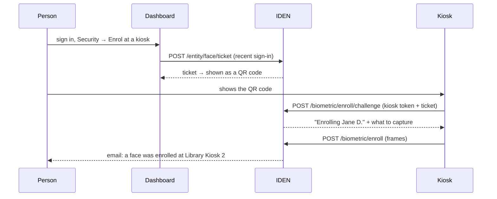

# Faces

IDEN can use a person's face as a **second factor**: after their password, never instead of it. It
is off by default — `IDEN_BIOMETRIC_ENABLED` turns it on, and the
[biometric engine](../operations/biometric-engine.md) has to be running.

## One to one, never one to many

Every comparison IDEN makes is **1:1**: this capture against the face enrolled on the account that
just signed in with a password. IDEN never searches everyone enrolled to find out who a face is.

An identity provider only ever asks *are you who you claim to be?* A search would answer a question
nobody here asks, and at a price: its false-match rate grows with every person enrolled, its
templates have to sit unencrypted where an index can read them, and it is the kind of biometric
processing regulators treat most strictly.

## Enrolling happens at a kiosk

A face is enrolled at a kiosk, never from a browser. A kiosk has a fixed camera in known light,
which makes better templates, and it is a place the person has to be in.

The kiosk signs in as itself, with `client_credentials` and the `biometric:enroll` scope. That
credential names nobody. **The ticket is what says whose face this is**, and only the person can
create one — after signing in to the dashboard within the last five minutes. So a stolen kiosk
secret, on its own, enrols no one.

A ticket:

- names one person, and lasts 15 minutes (`IDEN_FACE_TICKET_TTL`)
- allows five capture attempts — poor light should not end the visit, but a ticket is not a way to
  try forever
- is gone once a face is enrolled with it, and asking for a new one retires the old one

### Kiosks are registered devices

Every kiosk is registered in the dashboard and has a client of its own. A new device is **paired**:
an administrator registers the kiosk and is shown a short code, and the device trades it, once, for
its own secret. So:

- **one kiosk can be cut off without touching the others.** Revoking it deletes its client, and
  enrolment refuses a token whose client is not a registered kiosk, so it stops at once — even
  while its last access token has minutes to run;
- **a kiosk can be taken out of service** from the dashboard, and IDEN refuses its enrolments until
  it is put back;
- **every enrolment names the kiosk** — in the person's email, on their security page, and in the
  kiosk's own history in the dashboard, with why each failed attempt failed.

Setting one up is in [Kiosks](../operations/kiosks.md).

Enrolling again replaces the face on file. The person is emailed whenever a face is enrolled, with
where to remove it if it was not them, and the audit log records the kiosk and whose face it was.

## Signing in

Face is offered after the password, in two situations:

| Situation | What the person sees |
|---|---|
| An application asks for `acr_values=urn:iden:acr:mfa-face` | The face step. Nothing else reaches that level. |
| They have an authenticator app, which makes a second factor owed at every sign-in | A choice: their face or a code. Either one answers it. |

An enrolled face **does not** on its own make a second factor owed. Someone at a laptop without a
camera must still be able to sign in, and an authenticator app is the factor that carries that rule
— see [Assurance and step-up](assurance.md).

A successful face step adds `face` to `amr`; with the password that is `urn:iden:acr:mfa-face`.

## What "live" means

A face that matches is not enough. A photograph of the person matches too. Every capture has to pass
three checks, and each stops something different:

| Check | How | Stops |
|---|---|---|
| **Anti-spoofing model** | InsightFace's liveness model judges each straight-ahead frame | Printed photos, phone and screen replays |
| **Head movements** | Two of *turn left, turn right, look up, look down*, drawn at random for this attempt, measured from facial landmarks | A still photo; a recording made before the attempt began |
| **Consistency** | Every frame must show the same person | Swapping faces partway through |

The movements are a **challenge**: issued by IDEN, good for one capture, two minutes,
and one person. A capture made for one attempt is useless for the next.

The sign-in page and the kiosk wait for each movement rather than timing it. A head tracker running
in the browser (MediaPipe's face landmarker, served by IDEN, with no picture leaving the page for
it) follows the head, and a bar shows how far it has turned; the frames are taken once it has gone
far enough, while it is held there. The tracker only decides when the frames are taken: the engine
judges every one of them itself, so a modified page gains nothing.

When a capture is not good enough to judge — too dark, too far away, blurred, two faces — nothing is
decided. The person is told what to fix, and it does not count as a failed attempt. A capture that is
judged and fails is refused without saying which check failed, and five of those in fifteen minutes
lock face sign-in for that account for a while.

### What it does not stop

Be clear about this before relying on it:

- **A video stream injected into the browser.** A virtual camera fed by a real-time deepfake is the
  attack that matters for faces on the web. The random movements make it harder — the attacker has
  to render the right movements, live — but no check that runs on IDEN's side can prove a frame came
  from a real camera.
- **A screen the anti-spoofing model does not recognise.** Nothing else looks for a replay held up
  to the camera. IDEN does not flash the screen to test for one, because flashing colours can harm
  people with photosensitive epilepsy.
- **Identical twins**, and to a lesser degree close relatives.
- **Anything a certification would have found.** These checks are not tested by an accredited lab
  against ISO/IEC 30107-3 (presentation attacks) or CEN/TS 18099 (injection attacks). A deployment
  that needs that assurance replaces the anti-spoofing model with a certified product.

This is why a face is a second factor here and never the only one.

## What is stored

| | Where | Protected by |
|---|---|---|
| **Embeddings** — a few vectors per person, no image | `face_templates` in PostgreSQL | Encrypted with the same key as TOTP secrets, and bound to the account: a row copied onto another person does not decrypt |
| **Enrolment photos** | Blob storage, only with `IDEN_BIOMETRIC_KEEP_IMAGES=true` | Encrypted the same way |
| **Captures made at sign-in** | Nowhere | The engine sees them for the length of one request |

Removing a face — from the dashboard by the person, or by an administrator — deletes the
embeddings and any photos together.

Why keep photos at all? Embeddings from one model cannot be compared under another. Upgrade the
model and every face on file stops matching; without photos, everyone enrols again. With them,
`scripts.reembed_faces` moves the faces to the new model and nobody has to come back.

## The models

The engine runs open models by default, pinned by checksum in `engine/models.toml`:

| Job | Model | Licence |
|---|---|---|
| Detection | SCRFD-10G (InsightFace buffalo_l) | **Non-commercial research only** |
| Recognition | ArcFace R50, WebFace600K (InsightFace buffalo_l) | **Non-commercial research only** |
| Anti-spoofing | InsightFace liveness | **Non-commercial research only** |

**None of these licences permits commercial use.** A deployment that is not research replaces them
with weights it is licensed to use — a commercial SDK, or a model trained on data it has
the rights to. That is a change to `models.toml`, not to code.

The match threshold in `models.toml` is a conservative starting point, **not calibrated**: until it
is, the engine says `calibrated: false`. Calibrating means measuring on your own cameras and your
own people — see [the engine guide](../operations/biometric-engine.md#calibrate-the-threshold).
