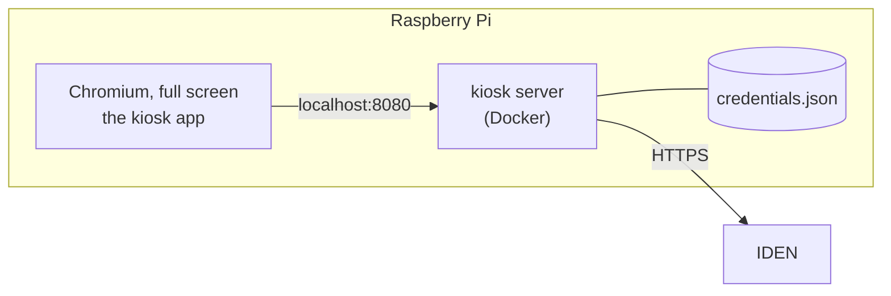

# Kiosks

A kiosk is where people enrol their face: a Raspberry Pi with a touchscreen and a webcam, standing
somewhere people can reach. Why enrolment happens there and not in a browser is in
[Faces](../concepts/biometrics.md#enrolling-happens-at-a-kiosk).

It needs the biometric module on and the [engine](biometric-engine.md) running.

## What runs on one



- **The kiosk server** holds the kiosk's client secret, signs in with `client_credentials`, reports
  in every minute, and passes captures to IDEN. It listens on the loopback only.
- **The kiosk app** is a page that server serves. It reads QR codes, runs the face capture and tells
  the person what happened. It never sees the secret.

## Hardware

| | Used and tested against | Notes |
|---|---|---|
| Computer | Raspberry Pi 5 (4 GB or more) | Raspberry Pi OS with desktop, 64-bit. Captures are analysed by the engine, not here, so the Pi only shows the screen. |
| Screen | A touchscreen, 7" or larger | Everything is touch: large buttons, an on-screen keypad for the pairing code. |
| Camera | Rapoo C280 (USB, UVC) | Any UVC webcam works. What matters is being able to lock its white balance, exposure and focus — see [the camera](#the-camera). |

Where it stands matters as much as what it is:

- **Light from the front.** A window or a bright lamp behind the person is the commonest cause of
  failed enrolments. Diffuse light on the face is best.
- **Camera at eye height,** above the screen, and the screen facing the person. The colour flashes
  are the screen lighting the face, so the face has to be in front of it, at about an arm's length.
- **Nothing reflective behind,** and no second face in view.

## Install

**1. Build and publish the image.** Once, from a clone, for every kiosk to pull:

```bash
docker buildx build --platform linux/arm64,linux/amd64 \
  --build-arg VERSION=$(git describe --always) \
  -t ghcr.io/<you>/iden-kiosk:latest --push kiosk
```

`kiosk/` holds everything the kiosk needs — the server, the client and the install files — and
nothing outside it is used. It can be built, and the folder handed over, on its own.

**2. Install on the Pi.** Copy `kiosk/deploy/` onto it, then:

```bash
cd deploy
sudo ./install.sh --issuer https://id.example.org --image ghcr.io/<you>/iden-kiosk:latest
sudo reboot
```

The script:

- installs Docker and starts the kiosk server;
- has Chromium open the kiosk app full screen when the desktop starts, and reopen it if it exits;
- allows the camera for that page alone, with no prompt;
- signs the desktop in automatically, so the kiosk comes back by itself after a power cut;
- turns off screen blanking and sets the backlight to full brightness;
- locks the camera's controls whenever it is plugged in;
- pulls a newer image every night.

Running it again is safe. After the reboot the screen says **Set up this kiosk**.

## Pair it

1. In the dashboard, **Administration → Kiosks → Register kiosk**. Give it the name people will see
   in their email — *Library Kiosk 2* — and where it is.
2. A pairing code appears, as a QR code and as eight characters. Hold the QR code up to the kiosk's
   camera, or tap **Type the code instead** on the kiosk and enter it.
3. The dashboard notices the device and says **Paired**. The kiosk shows its welcome screen.

The code lasts 15 minutes (`IDEN_KIOSK_PAIRING_TTL`) and works once. Registering or pairing a kiosk
needs `admin:kiosks:write` **and** both `biometric:` scopes, because the device receives them.

## The camera

The liveness check flashes the screen red, green and blue and looks for that colour on the face. A
camera left on automatic white balance corrects the colour away; automatic exposure dims the frame
under the flash; autofocus can hunt in the middle of a capture. All three are locked from
`/opt/iden-kiosk/camera.conf`, applied whenever the camera appears.

Control names and ranges differ between cameras, and the shipped values are a starting point.
**Tune them on the real camera, in the kiosk's real light:**

```bash
v4l2-ctl -d /dev/video0 --list-ctrls-menus     # what this camera has
sudo nano /opt/iden-kiosk/camera.conf          # set the values
sudo systemctl start iden-kiosk-camera@video0  # apply them now
```

The Rapoo C280's controls have not been checked against the shipped file. A control the camera
lacks is skipped with a warning in `journalctl -u 'iden-kiosk-camera@*'`.

Then watch the kiosk's history in the dashboard for a few enrolments. Mostly `poor_capture` means
the light or the exposure; mostly `not_live` from real people usually means the white balance is
still moving.

## In the dashboard

Each kiosk's page shows:

- **status** — *online* when it reported in within three minutes, *offline* when not, *not paired
  yet*, or *out of service*;
- the camera it is using (or that it has none), its software version and its address;
- every enrolment it attempted, whose face, and why the failed ones failed.

And its **settings**, which the kiosk picks up within a minute:

| Setting | What it does |
|---|---|
| In service | Off: the kiosk shows *out of service*, and IDEN refuses its enrolments immediately. |
| Clear the screen after | Seconds without a touch before the kiosk returns to its welcome screen, forgetting the person. 30–600. |
| Notice | A line on the welcome screen — opening hours, where to find help. |
| Camera | Part of the camera's name, when several are attached. |

## Replace or revoke

- **A replaced or reinstalled device:** on the kiosk's page, **Pair a new device**, and pair the new
  one. The old device's secret stops working the moment the new one pairs.
- **A lost or stolen device:** **Revoke kiosk**. Its client is deleted, and IDEN refuses it at once,
  even with an access token that has not expired. Faces it enrolled stay enrolled. A stolen kiosk
  could never enrol anyone on its own: every enrolment needs a ticket the person creates.
- **Un-pairing a device by hand:** `docker compose down -v` in `/opt/iden-kiosk` deletes its
  credentials.

A kiosk whose credentials IDEN refuses forgets them and shows **Set up this kiosk** again.

## Maintenance screen

Press and hold the top-left corner of the screen for five seconds. It shows the kiosk's name,
whether IDEN and the kiosk server can be reached, and the software version, and offers **Pair
again**. It needs no PIN: pairing needs a fresh code from an administrator anyway.

## Develop without a Pi

```bash
cd kiosk/server && uv sync && KIOSK_ISSUER=http://localhost:8000 uv run kiosk-server   # :8080
cd kiosk/client && pnpm install && pnpm dev                                           # :5180
```

Open `http://localhost:5180`; Vite passes `/api` to the kiosk server. The laptop's webcam stands in
for the kiosk's. The server's checks are the same four as the provider's, run from `kiosk/server`; the client's
are `pnpm typecheck && pnpm lint && pnpm build` in `kiosk/client`.

The client carries its own copies of three things the web apps share: the design tokens
(`src/theme.css`), the face capture (`src/ui/face-capture.tsx`, which auth-ui also has for sign-in)
and the capture-problem wording. A change to the provider's challenge format means changing both
face captures.

## When something is wrong

| Symptom | Cause |
|---|---|
| *Set up this kiosk* on a kiosk that was working | IDEN refused its credentials: it was revoked, or another device was paired in its place. |
| *Out of order* | The kiosk cannot reach IDEN. Check the network and `KIOSK_ISSUER` in `/opt/iden-kiosk/.env`. |
| *The camera is not working* | Chromium cannot open it. Check it is plugged in (`v4l2-ctl --list-devices`) and that `/etc/chromium/policies/managed/iden-kiosk.json` exists. |
| The dashboard says the camera is *None* | As above: the kiosk app reported that it has no camera. |
| Many `not_live` failures | Usually the light or the camera settings — see [the camera](#the-camera). |
| A blank screen after boot | The kiosk server is still starting; the browser waits for it. `docker compose -f /opt/iden-kiosk/compose.yml logs` if it does not come. |
