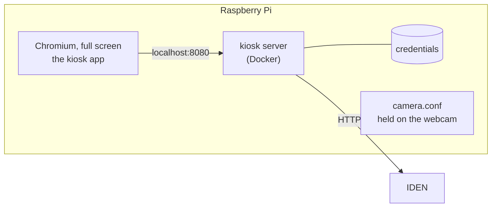

# Kiosks

A kiosk is where people enrol their face: a small computer with a touchscreen and a webcam, standing
somewhere people can reach. Why enrolment happens there and not in a browser is in
[Faces](../concepts/biometrics.md#enrolling-happens-at-a-kiosk).

Before you start, the biometric module must be on and the [engine](biometric-engine.md) running.

Setting up a kiosk takes five steps, and three places:

| Step | Where |
|---|---|
| [1. Build the kiosk image](#1-build-the-kiosk-image) | Your laptop or any machine with Docker, once for every kiosk |
| [2. Install on the Pi](#2-install-on-the-pi) | The Pi, from a terminal or over SSH |
| [3. Pair it](#3-pair-it) | The dashboard and the kiosk's screen |
| [4. Tune the camera](#4-tune-the-camera) | The Pi, with the kiosk in its real place |
| [5. Start kiosk mode at boot](#5-start-kiosk-mode-at-boot) | The Pi |

## What runs on one



- **The kiosk server** holds the kiosk's client secret, signs in to IDEN as the kiosk, reports in
  every minute, and passes captures on. It listens on the Pi's loopback only.
- **The kiosk app** is a web page that server serves. Chromium shows it full screen — *kiosk mode*.
  It reads QR codes, runs the face capture and tells the person what happened. It never sees the
  secret.
- **`iden-kiosk`** is the command you run the kiosk with: entering and leaving kiosk mode, status,
  logs, updates, the camera.

## Hardware

| | What to use |
|---|---|
| Computer | A Raspberry Pi 5 with 4 GB or more, running **Raspberry Pi OS with desktop, 64-bit**. The engine analyses the captures, not the Pi, so the Pi only has to show the screen. |
| Screen | A touchscreen, 7" or larger. Everything is touch: large buttons, an on-screen keypad for the pairing code. |
| Camera | Any USB webcam (UVC, which nearly all are). What matters is whether its white balance, exposure and focus can be set by hand — see [Choosing a camera](kiosk-camera.md#choosing-a-camera). |

Where it stands matters as much as what it is:

- **Light from the front.** A window or a bright lamp behind the person is the commonest cause of
  failed enrolments. Diffuse light on the face is best.
- **Camera at eye height,** above the screen, and the screen facing the person. The colour flashes
  are the screen lighting the face, so the face has to be in front of it, about an arm's length away.
- **Nothing reflective behind,** and no second face in view.

## 1. Build the kiosk image

**On your laptop**, or any machine with Docker — Linux, macOS or Windows, x86 or ARM. One image
serves every kiosk; it is built once and pulled by each.

Log in to the registry the image will live in, then run `kiosk/build.sh` from your clone:

```bash
docker login ghcr.io
kiosk/build.sh ghcr.io/<you>/iden-kiosk:latest
```

It builds for both the Raspberry Pi (arm64) and ordinary PCs (amd64), stamps the image with the
current commit, and pushes it. A few minutes the first time.

??? info "What it sets up on a Linux machine"
    Building for two platforms at once needs two things Docker Desktop has built in and Docker
    Engine on Linux does not. The script adds both when they are missing:

    - a **buildx builder** named `iden-kiosk` with the `docker-container` driver, because the
      default builder cannot produce a multi-platform image;
    - **QEMU**, registered with the kernel by `tonistiigi/binfmt`, so an x86 machine can run the
      arm64 build steps.

    It needs the buildx plugin itself: `sudo apt-get install docker-buildx-plugin` with Docker's
    own packages, or `docker-buildx` with Ubuntu's `docker.io`.

**The image is private by default on GitHub.** Either make the package public (GitHub → your
profile → Packages → `iden-kiosk` → Package settings → Change visibility), or log in on every Pi
before installing, with a token that has the `read:packages` scope:

```bash
sudo docker login ghcr.io
```

`sudo`, because the install and the nightly updates pull as root.

!!! tip "No registry?"
    Build on the Pi itself instead. Copy the whole `kiosk/` folder to it, then
    `kiosk/build.sh --local` there. That produces `iden-kiosk:local` on the Pi, which you give to
    the installer as `--image iden-kiosk:local`. Nightly updates then have nothing to pull; rebuild
    and run `iden-kiosk update` to upgrade.

## 2. Install on the Pi

**On the Pi.** Start from a fresh Raspberry Pi OS with desktop, signed in as the user the screen
will run as (`pi` here). Copy `kiosk/deploy/` from your clone onto it, for example from your laptop:

```bash
scp -r kiosk/deploy pi@kiosk.local:
```

Then, on the Pi:

```bash
cd deploy
sudo ./install.sh --issuer https://iden.example.org --image ghcr.io/<you>/iden-kiosk:latest
```

`--issuer` is IDEN's public address, exactly as in `IDEN_ISSUER`. The script:

- installs Docker, Chromium and the camera tools, if they are missing;
- starts the kiosk server, and has it restart on its own after a reboot;
- installs the **`iden-kiosk`** command;
- holds the camera at the settings in `/opt/iden-kiosk/camera.conf` whenever it is plugged in;
- allows the camera for the kiosk app alone, with no prompt;
- turns off screen blanking and sets the backlight to full brightness;
- pulls a newer image every night.

It does **not** enter kiosk mode, and it does not change how the Pi starts. The desktop stays a
desktop until you ask. Running the script again is safe; it keeps a tuned `camera.conf`.

**Check it worked:**

```bash
iden-kiosk status
```

```text
Server         running (Up 2 minutes)
Paired         no — pair it from the dashboard
IDEN           not asked yet
In service     yes
Version        8fc4714
Issuer         https://iden.example.org
Kiosk mode     off (iden-kiosk start to enter)
At boot        does not start (iden-kiosk enable)
Camera         /dev/video0 USB 2.0 Camera
```

`Server` must be running and a camera listed. If the server is not running, `iden-kiosk logs`
says why.

## 3. Pair it

1. **On the Pi**, enter kiosk mode: `iden-kiosk start`. The screen says **Set up this kiosk**.
2. **In the dashboard**, **Administration → Kiosks → Register kiosk**. Give it the name people will
   see in their email — *Library Kiosk 2* — and where it is.
3. A pairing code appears, as a QR code and as eight characters. Hold the QR code up to the kiosk's
   camera, or tap **Type the code instead** on the kiosk and enter it.
4. The dashboard says **Paired**, and the kiosk shows its idle screen.

The code lasts 15 minutes (`IDEN_KIOSK_PAIRING_TTL`) and works once. Registering or pairing a kiosk
needs `admin:kiosks:write` **and** both `biometric:` scopes, because the device receives them.

## 4. Tune the camera

Before anyone enrols, set the camera up in the kiosk's real place and light. It takes about twenty
minutes, and decides how often enrolment works first time. Follow
**[Tuning the kiosk camera](kiosk-camera.md)**.

## 5. Start kiosk mode at boot

Once it works, have the kiosk come back by itself after a reboot or a power cut:

```bash
iden-kiosk enable
sudo reboot
```

`enable` also makes the desktop sign in automatically, since kiosk mode starts when the desktop
does. After the reboot the kiosk's idle screen should appear on its own. `iden-kiosk disable`
undoes it; the desktop then still signs in by itself, which you can turn off in
`sudo raspi-config` → System Options → Boot / Auto Login.

## Running it

Everything is done with `iden-kiosk`, on the Pi or over SSH. It asks for `sudo` when it needs to.

| To | Run |
|---|---|
| Enter kiosk mode now | `iden-kiosk start` |
| Leave it, back to the desktop | `iden-kiosk stop` |
| Reopen the kiosk app | `iden-kiosk restart` |
| Enter it at every boot, or stop doing so | `iden-kiosk enable`, `iden-kiosk disable` |
| See what is running | `iden-kiosk status` |
| Follow a log | `iden-kiosk logs` (the server), `iden-kiosk logs browser`, `iden-kiosk logs camera` |
| Update now, not tonight | `iden-kiosk update` |
| List the camera's settings | `iden-kiosk camera` |
| Change the camera's settings | `iden-kiosk camera edit` |
| Forget the pairing | `iden-kiosk unpair` |

**When nobody is using it**, the kiosk shows an idle screen: what it is for, the three steps to
enrol, and the time — with the camera **off**, so it films nobody passing by. Touching the screen
opens the QR scanner. Every visit ends back there: a result, *Not me*, *Back*, or nobody touching the
screen for the **Clear the screen after** time set in the dashboard.

In kiosk mode Chromium cannot be closed from the screen: if it exits for any reason, it is back two
seconds later. Leave kiosk mode from a terminal, usually over SSH: `iden-kiosk stop`.

**Updates** are pulled every night between 03:30 and 04:00. A kiosk that cannot reach the registry
keeps running the image it has.

## In the dashboard

Each kiosk's page shows:

- **status** — *online* when it reported in within three minutes, *offline* when not, *not paired
  yet*, or *out of service*;
- the camera it is using (or that it has none), its software version and its address;
- every enrolment it attempted, whose face, and why the failed ones failed.

And its **settings**, which the kiosk picks up within a minute:

| Setting | What it does |
|---|---|
| In service | Off: the kiosk shows *out of service*, and IDEN refuses its enrolments immediately. |
| Clear the screen after | Seconds without a touch before the kiosk returns to its idle screen, turning the camera off and forgetting the person. 30–600. |
| Notice | A line at the bottom of the kiosk's screens — opening hours, where to find help. |
| Camera | Part of the camera's name, to choose one when several are attached. |

## Replace or revoke

- **A replaced or reinstalled device:** on the kiosk's page, **Pair a new device**, and pair the new
  one. The old device's secret stops working the moment the new one pairs.
- **A lost or stolen device:** **Revoke kiosk**. Its client is deleted, and IDEN refuses it at once,
  even with an access token that has not expired. Faces it enrolled stay enrolled. A stolen kiosk
  could never enrol anyone on its own: every enrolment needs a ticket the person creates.
- **Un-pairing a device by hand:** `iden-kiosk unpair` deletes its credentials, and the screen asks
  for a pairing code again.

A kiosk whose credentials IDEN refuses forgets them and shows **Set up this kiosk** again.

## Maintenance screen

Press and hold the top-left corner of the screen for five seconds. It shows the kiosk's name,
whether IDEN and the kiosk server can be reached, and the software version, and offers **Pair
again**. It needs no PIN: pairing needs a fresh code from an administrator anyway.

## Develop without a Pi

On your laptop, with the provider running from source:

```bash
cd kiosk/server && uv sync && KIOSK_ISSUER=http://localhost:8000 uv run kiosk-server   # :8080
cd kiosk/client && pnpm install && pnpm dev                                           # :5180
```

Open `http://localhost:5180`; Vite passes `/api` to the kiosk server. The laptop's webcam stands in
for the kiosk's. The server's checks are the same four as the provider's, run from `kiosk/server`;
the client's are `pnpm typecheck && pnpm lint && pnpm build` in `kiosk/client`.

The client carries its own copies of three things the web apps share: the design tokens
(`src/theme.css`), the face capture (`src/ui/face-capture.tsx`, which auth-ui also has for sign-in)
and the capture-problem wording. A change to the provider's challenge format means changing both
face captures.

## When something is wrong

| Symptom | Cause |
|---|---|
| `build.sh` stops at `the buildx plugin is missing` | Install it: `sudo apt-get install docker-buildx-plugin` (Docker's packages) or `docker-buildx` (Ubuntu's). |
| `build.sh` fails pushing, with `denied` or `unauthorized` | Not logged in to the registry on that machine: `docker login ghcr.io`, with a token allowed to write packages. |
| `install.sh` fails pulling the image, with `unauthorized` or `not found` | The package is private and the Pi is not logged in — `sudo docker login ghcr.io` — or `--image` is misspelt. |
| `iden-kiosk start` says nobody is signed in to the desktop | Kiosk mode needs the desktop running as the user given to `install.sh`. Sign in on the screen, or `iden-kiosk enable` and reboot. |
| Kiosk mode does not start by itself after `iden-kiosk enable` | `iden-kiosk status` should say *starts by itself*. If it does, this desktop does not run the standard autostart entries. Add the line `/opt/iden-kiosk/autostart.sh &` to the end of `/etc/xdg/labwc/autostart` and reboot. |
| *Set up this kiosk* on a kiosk that was working | IDEN refused its credentials: it was revoked, or another device was paired in its place. |
| *Out of order* | The kiosk cannot reach IDEN. `iden-kiosk status` shows the issuer it uses; check the network, and that the address opens in a browser. |
| *The camera is not working* | Chromium cannot open it. Check it is listed by `iden-kiosk status`, and that `/etc/chromium/policies/managed/iden-kiosk.json` exists. |
| The dashboard says the camera is *None* | As above: the kiosk app reported that it has no camera. |
| Many `poor_capture` or `not_live` failures | The light, or the camera settings. See [Tuning the kiosk camera](kiosk-camera.md#reading-the-results). |
| A blank screen in kiosk mode | The kiosk server is still starting; the browser waits for it. `iden-kiosk logs` if it does not come. |
